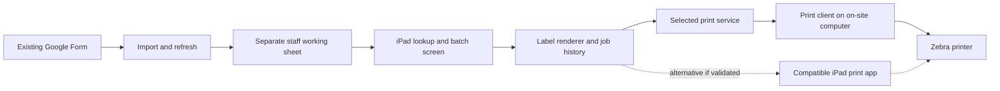

# Pickup labels: phase-one specification

Status: Standalone pilot implemented locally; Google deployment and physical printer validation outstanding  
Prepared: November 4, 2026  
Project: Front Range Food Source

## Recommendation

Keep the existing Google Form. Add a small, staff-only pickup-label tool that reads its responses, lets staff find a household, and prepares correctly sized adhesive labels. Support both advance batch printing and printing at check-in. A Google Apps Script web app with a separate working Google Sheet is the preferred low-infrastructure starting point, subject to proving staff authentication and a dedicated printing connection.

The user clarified that there is no general-purpose iPad printing app. Printing currently happens inside the church management system’s children’s check-in workflow. That proves the equipment can print in that system; it does not establish an integration that our software can reuse.

The first development milestone is a real label printed from our own workflow on the actual iPad through the actual Zebra printer. The recommended pilot is a small web app plus an existing print service and its client on the already available Windows PC. Start with the USB-connected printer; add the Wi-Fi printer after verifying that the PC can reach it. Direct iPad printing remains an alternative only if operating the PC during pickup proves impractical. Do not buy replacement hardware before testing the equipment.

For example, PrintNode supplies a cloud API and a client installed on a computer with access to the printer. Our authenticated backend would submit the generated label to that API; the local client would deliver it to the printer. This is a candidate, not a verified match for this printer. Confirm driver/raw-format support, licensing, service data handling, and real output before selecting it. [PrintNode client requirements](https://www.printnode.com/en/download) · [PrintNode API](https://www.printnode.com/en/docs/api/curl)

This approach builds the food-pickup interface while using an existing printing service for delivery. It requires an awake, connected computer during pickup and working internet. Keep API credentials server-side and bind jobs to a configured printer. Using the same physical printer must preserve the church’s settings and avoid interleaving church and food-pickup batches; do not assume the church software or its print server accepts outside jobs.

These are local planning documents. Phase one is operationally independent of the existing Next.js/Firebase food-order application. No production application changes, GitHub publication, Google data changes, or physical printer tests have been performed; the standalone pilot is local code only.

## Confirmed equipment and proposed connection

User-provided photos identify a **Zebra ZD421** (photos 1–2) and a **Zebra GX420d** (photos 3–4). The user confirms one printer uses Wi-Fi and the other connects by USB to a small Windows PC. Which model uses which connection has not been explicitly confirmed; do not infer that assignment from the photos. Label dimensions, installed ZD421 resolution, Windows version, and printer queue names remain unverified.

Use the existing Windows PC as the print station for the pilot:

1. Confirm that the USB printer can print from Windows independently of the church app.
2. Install/configure the selected print client on that PC and test an authenticated application job to the USB queue.
3. If the PC can reach the Wi-Fi printer, install a separate Windows queue for it, using a stable network address. Test it through the same client. Network segmentation or client isolation may need attention from the site's administrator.
4. Give each destination a clear station name. Select one destination per job and store the destination and label profile with the job. Do not broadcast to both printers or automatically fail over an uncertain job.
5. Test after a PC restart, under the actual account or Windows service that will run during pickup. Keep the PC awake and connected. A printer visible in one user's Windows session may not be available to the service account.

PrintNode documents support for OS-visible network printers through its running local client and RAW printer-language jobs. This makes one PC serving both printers a plausible architecture, subject to testing their installed queues. [PrintNode FAQ](https://www.printnode.com/en/faq) · [RAW printing](https://www.printnode.com/en/docs/what-is-raw-printing)

Use **ZPL as the first output format to test**. Zebra documents ZPL support for the GX420d and ZD421 family. The GX420d is 203 dpi; the ZD421 has 203/300 dpi variants, so each printer needs its own verified resolution and stock profile. Share the logical three-field layout, not an unscaled fixed set of printer coordinates. [GX420d manual](https://www.zebra.com/content/dam/support-dam/en/documentation/unrestricted/guide/product/gx420d-gx430d-ug-en.pdf) · [ZD421 specifications](https://www.zebra.com/us/en/products/spec-sheets/printers/desktop/zd400-series.html)

The photos do not establish AirPrint support or direct access from iPad Safari. Under the proposed service route, even the Wi-Fi printer receives jobs through the Windows client. No new printer or native iPad app is planned for the pilot. Actual installation and physical output testing remain outstanding.

## Station computer flexibility

The mounted Windows PC does not need to move. The pilot can use a supported Mac or Windows laptop with the print client and printer configured, kept powered, awake, and online at the packing station. The browser/server app is independent of that operating-system choice; changing stations requires updating the printer ID and verifying the label profile. The exact pilot laptop and printer connection are still to be selected.

## Selected pickup workflow and implementation

The user selected the restaurant-style workflow: mobile volunteers check households in beside their cars, and that action sends labels to the fixed packing station. The primary button is **Check in & print**. Arrival and the initial print job are saved together under a server lock; a printer failure leaves arrival recorded. Retries or two volunteers checking in the same household reuse the initial arrival job. Explicit reprints remain possible with a reason. Physical label receipt tells the packing team to begin; a packing-station view also lists arrivals and label problems, but does not track packing completion or food collected.

Advance printing remains a secondary feature. Because a fresh arrival label signals packing, check-in after advance printing normally prints another set, with a UI warning. Staff may explicitly check in without printing when using prepared labels, but then must notify packers directly; the arrival is also visible on the packing-station screen with a missing-label warning.

The local implementation is in [tools/pickup-station](../../tools/pickup-station/README.md). It contains Apps Script code, the mobile interface, a fictional-data demo, a configuration template, and service-mocked tests. Its README records deployment steps and narrower pilot limits, including revocable church-device access, a read-only Sheet adapter or direct Form adapter, one printer, manual physical confirmation, and unimplemented retention automation. Requirements below describe the fuller target; they are not a claim that every feature is deployed or hardware-tested.

## What staff will do

### At check-in

1. Open the tool on the iPad and select the pickup event.
2. Search by name or phone digits. See enough information to distinguish people with the same name.
3. Select the correct registration and verify the household size. Previously printed labels are clearly indicated.
4. Choose a label quantity and tap **Check in & print**. Start with a proposed default of three identical labels: one for the order paperwork, one for the box, and one for check-in paperwork. Staff can choose one, two, or three.
5. Submit through the selected printing connection; complete an app handoff only if that route is selected. Confirm that the labels physically came out if the connection cannot report completion reliably.
6. Packing staff receive and attach the labels at the packing station. The volunteer stays beside the cars. Arrival has already been saved; print status and food pickup remain distinct.

The labels contain only the requested name, phone number, and household size. Email is not needed. If car color is still operationally useful, staff can write it on the order paperwork at arrival. It should not delay this first version or expand the printed fields.

### Ahead of pickup

1. Select an explicit pickup event and refresh responses.
2. Resolve missing or ambiguous data; review the count of valid registrations and labels.
3. Select all eligible registrations or a subset. Review duplicates rather than silently combining them.
4. Choose copies per registration. For example, 80 registrations × 3 copies = 240 labels.
5. Print a small test, then print manageable batches. Keep each household's copies adjacent, sorted by last name where separately available, otherwise by full name.
6. Use **Print new or changed registrations** after a later refresh. Do not print the entire event again by default.

Advance printing does not imply attendance. A person with labels already prepared can still be checked in without printing again.

## Options and tradeoffs

| Option | Best use | Limitations | Decision |
| --- | --- | --- | --- |
| Google responses → CSV → newly selected label app/template | Fast pilot or advance batches | Must find a compatible app with CSV import; repeated importing is awkward at check-in | Optional pilot |
| Google responses → small iPad web tool → compatible iPad print app | Search and print on demand, plus batches | No such app is currently installed; requires verified printer support and an integration | Alternative if no computer is available |
| Web tool → existing print service → on-site computer → Zebra | Fixed printing station controlled from iPads | Requires an awake computer, internet, compatible client/driver, and service license | Recommended pilot using the existing Windows PC |
| Google responses → sheet-label PDF → office printer | Advance preparation and backup | Requires exact adhesive-sheet template; wastes stock for individual arrivals | Secondary output |
| Custom native iPad app using Zebra SDK | Direct integration when other routes fail | Larger development, deployment, and support scope | Defer unless required |

A CSV is a table of values, not a printable label layout. A PDF describes the page appearance. ZPL is a printer command format used by compatible Zebra devices. The chosen printing app or connection must accept the output we generate.

## Printing feasibility gate

Document the following before choosing a transport:

- Exact printer model and installed connectivity options, not just the Zebra brand.
- Church management/check-in software name/version and how it reaches the printer today, including any intermediary computer or print-server appliance.
- iPadOS version and whether the printer connects using Bluetooth, Wi-Fi, Ethernet through the network, or an intermediary computer.
- Actual label width and height, feed orientation, gap/black-mark sensing, print resolution, and supported printer language.
- For any proposed printing product: supported printer models/formats, multiple-copy behavior, documented API or app integration, and operating costs. Do not assume the church app exposes its printing functions.
- Pickup-site connectivity and the existing Windows PC’s operating system, uptime, install permissions, and network access to the Wi-Fi printer.

Test routes in this order:

1. Identify the existing church printing topology. If a suitable computer is available, test a standalone print client/service such as PrintNode from our own authenticated backend, independently of the church app. Test one label and a batch; record speed, format support, recovery, and effects on existing printer settings. If no computer is available, evaluate a compatible iPad printing app with a documented integration. A church-specific print appliance must not be assumed to support third-party jobs.
2. If the setup genuinely supports AirPrint, test a label-sized PDF from the iPad. Check real paper size and scaling. Apple's instructions require a compatible printer and network connection. [Apple AirPrint instructions](https://support.apple.com/en-us/109349)
3. For an appropriate Zebra model, test a supported native-file workflow. Zebra documents sending printer-language files through its Printer Setup Utilities; PDF submission depends on PDF Direct being installed and enabled. This is a feasibility route, not a promise of a fast production interface. [Zebra iOS printing guidance](https://support.zebra.com/article/000015576)
4. If existing services do not fit, evaluate building a queue serviced by a local computer connected to the printer. The computer retrieves authorized jobs over HTTPS; do not expose a printer port publicly or assume a cloud web app can reach a private printer address.
5. Only then estimate a native iPad app. Zebra provides a Link-OS SDK, but printer compatibility must be checked. [Zebra SDK support](https://www.zebra.com/gb/en/support-downloads/software/printer-software/link-os-multiplatform-sdk.html)

Zebra's Browser Print support page lists Windows/macOS and Android connections, not iPadOS. Its JavaScript library alone is not an established iPad printing solution. [Zebra Browser Print](https://www.zebra.com/us/en/support-downloads/software/printer-software/browser-print.html)

**Gate passes when:** the actual iPad/printer combination produces one correctly sized label and a batch of at least ten distinct fictional registrations, including three copies per registration, with readable text, correct ordering, and no unexpected blank labels. Record the output format and whether success can be detected or needs staff confirmation.

## Label design

Illustrative content, not actual client data:

```text
MARIA GARCIA
Phone: (303) 555-0142
Household: 5 people
```

- Start by testing a roughly 3 × 2 inch adhesive label if the installed printer and stock support it. Final dimensions follow the actual equipment; smaller printers may require a narrower layout.
- Use a large bold name, a clearly readable phone number, and a prominent household count. Allow two lines for long names rather than silently cutting them off.
- Print black text on white stock, with a tested margin. No logo, QR code, address, or email in the first template.
- Preserve accented names. Validate font/encoding support with the actual printer or render text through a supported image/PDF route.
- Set page dimensions explicitly for PDF output and printer dimensions/resolution explicitly for native output. Never assume 4 × 6 shipping-label defaults or scale to fit.
- An eight-per-sheet version is a separate template for an office printer. Match the exact stock product, margins, row spacing, and label dimensions. Do not assume eight labels implies a particular size. A roll printer prints individual labels, not an eight-label sheet.

## Source data and mapping

The response form remains the source of truth. Avoid sorting, rewriting, or adding operational state to the original response data. Use a separate staff-only working sheet for normalized records and job history.

Preferred ingestion is directly from the existing Google Form using its response IDs and item IDs, with a form submission trigger and an explicit refresh/backfill operation. This gives stable identity across imports and avoids relying on row positions. Google exposes response IDs and item responses through `FormResponse`. [Google FormResponse reference](https://developers.google.com/apps-script/reference/forms/form-response)

If only the response spreadsheet is accessible, use its column headers for a configurable mapping. Provision a persistent source identifier in an approved helper column or another reliable source-key arrangement before supporting unattended synchronization. Row number or a name/phone combination is not a safe durable identity. For a one-time CSV pilot, assign import IDs and clearly treat it as a snapshot; subsequent exports need reconciliation rather than blind append.

| Target field | Mapping and handling |
| --- | --- |
| `full_name` | One question, or configured first/last-name questions; trim whitespace and preserve original spelling |
| `phone_display` | Treat as text; preserve leading zeros, country code, and extensions; format only when unambiguous |
| `phone_search` | Separate normalized digits for lookup; never used as a unique registration ID |
| `household_size` | Explicit total-household answer; positive integer. Sum adult/child fields only after staff confirms the groups are exhaustive and do not overlap |
| `event_id` | Explicit pickup-event response, or staff-approved assignment of selected registrations to an event |
| `source_key` | Form ID plus response ID, or another verified stable source identifier |
| `source_updated_at` / `revision` | Last source observation and content revision for detecting changed labels |

An event is required even though its date is not printed. Submission date alone must not silently determine pickup date. One family may submit in several weeks. Store event dates as local calendar dates in America/Denver.

An administrator selects each source field once and sees a preview of sample records before activating the mapping. Missing/renamed fields fail visibly. A total-household field must not be confused with a count of children or adults.

Missing name, phone, or household count enters **Needs review**; never substitute zero or another person's data. Staff can record an audited correction or an explicit **No phone** exception. Do not block service to a household because it lacks a phone; record the exception and print the agreed wording. Existing order content remains on the original order paperwork.

## Proposed application design



Use Apps Script for the small server-side import, working-sheet access, and staff web interface if the access model passes testing. Google supports web-app deployment with different execution identities; use the separate staff and coordinator deployments described in the implementation README. [Google web-app deployment](https://developers.google.com/apps-script/guides/web)

A submit trigger provides prompt updates; a manual refresh reconciles existing responses, missed submissions, and edited answers. Do not assume a new trigger backfills historical responses or captures every kind of edit. Show last successful refresh and source errors. Trigger ownership must belong to a maintained organizational account. [Google installable triggers](https://developers.google.com/apps-script/guides/triggers/installable)

Keep three separate interfaces in the implementation:

- **Source adapter:** returns normalized registrations and stable source keys.
- **Renderer:** accepts a validated registration, a label profile, and copy count; returns a supported print payload.
- **Transport:** hands the payload to the verified app or queue and reports only what it can actually observe.

This separation allows phase two to replace Google Forms with the existing application's order data without redesigning the labels or printing path.

### Staff screens

1. **Pickup list:** event selector, refresh status, search, needs-review filter, and printed/prepared indication.
2. **Registration detail:** name, phone, household size, source revision, check-in state, label preview, copies selector, print, and explicit reprint.
3. **Batch review:** selected registrations, excluded/problem records, total labels, copies, sort order, and print confirmation.
4. **Setup/admin:** source mapping, event assignment, printer profile, access settings, and diagnostic test label.

Do not expose printer command languages or source-column configuration in routine volunteer screens.

## Job tracking and recovery

Maintain registrations separately from print jobs. Each job stores a unique ID, request token, event, record IDs and revisions, immutable rendered-data snapshot, copies per record, actor, timestamps, transport, and status.

Statuses: **Prepared**, **Submitted**, **Confirmed by staff**, **Failed**, **Outcome unknown**, and **Canceled**. A file download or successful handoff is not evidence that adhesive labels emerged. If the chosen transport provides device status, record precisely what that status means.

- A double tap or request retry with the same token returns the existing job. Use a server-side lock around shared sheet updates; do not rely on button disabling alone.
- A deliberate reprint creates a new job linked to the original, with a reason. Warn when labels for that same registration revision were already submitted or confirmed.
- Never automatically resend an outcome-unknown job; staff checks the printer first. Physical printing cannot be assumed exactly once after a lost acknowledgement.
- Batches have ordered per-registration entries, so a paper jam can be reconciled at the last confirmed household. Resume selected remaining entries, not the entire batch silently.
- Source corrections create a new revision and flag previously prepared labels as outdated. Existing job snapshots remain unchanged.
- Separate same-name or same-phone registrations remain separate until reviewed. Never merge two households automatically.
- Check-in and pickup state are independent of job state. Printing must never mark food collected.

## Access and operational safeguards

- Enroll church iPads once with coordinator-issued codes; volunteers need no Google sign-in or spreadsheet permissions. Require revocable device authorization for every staff data/print operation. The public page contains only an enrollment shell; sheets stay private.
- Prove the Apps Script identity behavior with an allowed and a denied user. Do not assume the active user's email is available when executing as the owner; Google documents restrictions. If identity cannot be enforced with the organization's account setup, use a separately authenticated backend. [Google Session identity reference](https://developers.google.com/apps-script/reference/base/session)
- Allow source mapping and corrections only to designated coordinators. Volunteers get pickup lookup and print actions.
- Keep source credentials and any printer-queue secrets off the iPad page. Escape HTML and printer-control characters; treat form text as data, never as printer commands. Protect CSV exports against spreadsheet formula interpretation.
- Keep phone numbers out of routine technical logs. Restrict any generated files to authorized staff and remove temporary files on a short, documented schedule.
- Proposed retention for phase-one working records and detailed print snapshots: 30 days after pickup, pending confirmation against the organization's existing retention needs. Preserve original source records according to its existing policy.
- Phase one is online-first. Provide a preprinted roster/labels or an approved downloaded backup before pickup. Do not promise offline synchronization. If connectivity fails, clearly indicate unavailable/stale data and use the fallback process.

## Acceptance criteria

1. Historical entries and new submissions appear under the correct event; re-import creates no additional records for the same source key.
2. Staff can find a household by name or phone and distinguish identical names.
3. The label shows the correct three fields, at the tested stock size, including long/accented names and household counts with two digits.
4. One, two, and three copies work; batch labels remain grouped per household.
5. Batch preview totals match physical output in the hardware pilot. Advance printing does not check people in.
6. Missing fields, same-name households, changed responses, repeat submissions, and canceled print dialogs have explicit outcomes.
7. Double taps and two iPads requesting the same action do not silently generate duplicate jobs; deliberate reprints remain possible.
8. Printer disconnects, paper-out conditions, partial batches, and uncertain outcomes can be recovered without blindly reprinting everything.
9. An unauthorized account cannot read registration data, export it, or submit jobs.
10. Proposed pilot target: at least 9 of 10 searches return within two seconds on the event dataset; at least 9 of 10 print attempts produce the first label within ten seconds after the staff member initiates printing, including any required app handoff. Measure on site; these are targets, not established capabilities.
11. A volunteer can complete lookup, verification, printing, and check-in after a short training session, with less handwriting than the current workflow.

## Phase-two boundary

Later, connect the source adapter to the existing Front Range Food Source application's orders, reuse its staff authorization where suitable, and map its order/batch IDs to the normalized model. Plan a cutover that prevents the Google and application sources from producing duplicate labels for the same registration. QR codes, richer packing instructions, inventory, SMS notifications, and custom native apps are separate decisions.

## Inputs still needed

- Confirm which of the identified ZD421/GX420d models uses Wi-Fi versus USB; provide label dimensions, ZD421 resolution, Windows version, and church software name.
- Access to the existing Form or response sheet and the exact field headings/questions.
- How pickup events are identified in existing responses.
- Typical and peak registrations per event, number of simultaneous staff iPads, and whether the existing Windows PC can remain running and reach both printers during pickup.
- Church iPads will be enrolled once with no volunteer sign-in. Confirm the proposed default of three labels.

Both advance printing and check-in printing were explicitly requested. No standalone iPad printing app is currently in use; the church check-in software supplies the existing printing workflow. Other defaults above remain proposals until validated.
